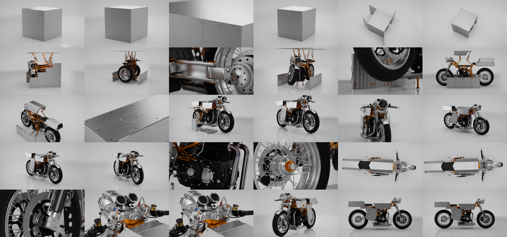

# Cube → Café Racer (Blender 5.2, Cycles)

A brushed-aluminium 1.1 m cube pops its seams, swings its doors around the corners, drops its walls and unfolds
mechanically into a café-racer motorcycle. 45 s, 1080p, 30 fps, no rider, no text.

| What | Where |
|---|---|
| Film (1080p, 30 fps, 45 s, with sound) | `media/cube_bike_1080p30.mp4` |
| Stills | `media/stills.jpg` |
| All source (fully procedural, no external 3D assets or textures) | `src/` |
| Sound cue sheet, mix script, credits | `audio/` (`CREDITS.md`, `mix_report.md`, `cues.json`, `mix.py`) |

Not in this repository: rendered frames and the downloaded music / SFX files (sources and licences are listed in
`audio/CREDITS.md`). Animated shots were rendered at 1600x900 on a laptop CPU and upscaled; stills are high-res.

## How it is built

Everything is generated by Python inside Blender; there is no hand-made .blend.

* `common.py`, `timeline.py`, `shots.py` – dimensions, the animation timeline, the 22-shot edit (cut to the music's beat grid).
* `cube.py` – the cube skin: 48 wall panels and 15 lid panels, each a machined part (brushed skin, screw rows,
  rib grid, slider shoes, hinge knuckles). The lid is the unfolded net of the tank and the tail.
* `chassis.py`, `parts/chassis_detail.py` – trellis frame, folding single-sided swingarm, shock, sliding seat carriage,
  rearsets, wiring, electrics.
* `parts/engine.py`, `parts/wheels.py`, `parts/front.py` – engine + exhaust, wire wheels + brakes + final drive,
  fork / bars / headlight / gauges / brake lines.
* `film.py`, `rigbase.py` – the rig: every frame is a pure function of time (`Film.pose(T)`): doors swing 270° around the
  cube corners, wall rows telescope, the swingarm unfolds like a folding rule, the head rakes out, the lid folds into
  tank and tail, wall stacks become keel, side covers and under-seat tray. Arms and hydraulic struts are solved per frame.
* `studio.py`, `mats.py` – high-key studio (floor that dissolves into the backdrop, panel dome, soft boxes), materials.
* `render_film.py`, `run_final.sh` – render driver (stills, locked shots as plate + region, moving shots), resumable.
* `post.py` – assembly: compositing, 2D moves on stills, in-between frames, grade, grain, impact shake, encode + audio.
* `make_cues.py`, `audio/mix.py` – sound cue sheet from the animation timeline, and the mix built from it.

Re-render (CPU, many hours; paths in the scripts point to `E:/fable3ddemos/3ddemo4`): `bash src/run_final.sh all <shot names>`, then `python3 src/post.py --audio audio/mix.wav`.

## License

Code: MIT (see `LICENSE`). The music and sound effects in the video keep their own licences (see below).

## Audio credits

Nothing is synthesised: the mix only cuts, layers, pitches and levels downloaded recordings.
Music: "Punctus XII" by Eugenio Mininni (Mixkit Stock Music Free License, no credit required).
Sound effects from Freesound (CC0 and CC BY 4.0) and Mixkit. **If you post the video, paste the CC BY credit lines from
`audio/mix_report.md` (section "Credits required") into the description.**
